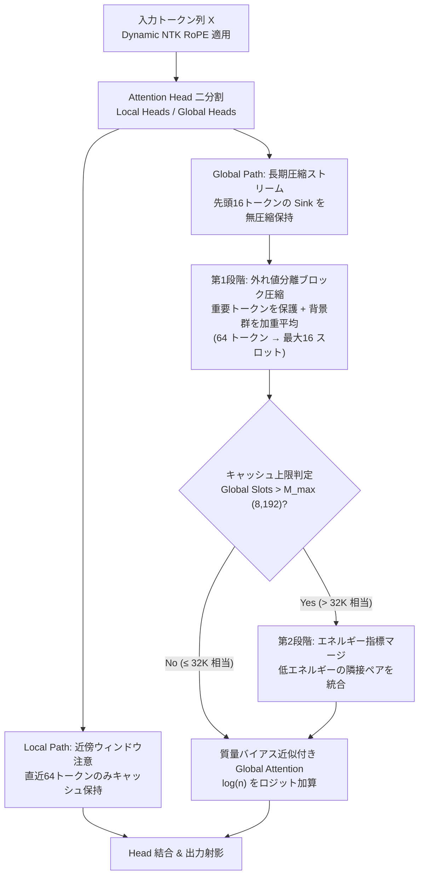

# AnchorMass: Bounded KV-Cache Long-Context Language Modeling

[](LICENSE)
[](https://www.python.org/downloads/)
[](https://pytorch.org/)

**AnchorMass** は、超長文処理時でも Key-Value (KV) キャッシュの増大を防ぎ、上限スロット数（$M_{\max}=8,192$）と一定のメモリ容量（約 259 MiB）に抑えながら長文文脈を保持・想起できる新しい注意機構 **AnchorMassAttention** を備えた言語モデルです。

同一の 158.6M パラメータ構成を持つ標準 Transformer（Standard-150M）との実測対照評価において、**32K から 256K の超長文全域で KV キャッシュを 258.58 MiB に一定化**し、デコード速度を 75.2〜76.6 tok/s に維持する性能を実証しています。

詳細は [`paper.md`](paper.md) をご覧ください。  
モデル (AnchorMass-150M)は[Hugging Faceリポジトリ](https://huggingface.co/rsu/AnchorMass-Attention)を参照ください。


## Feature

1. **Local / Global 注意ヘッド分割**:
   - 近傍 64 トークンをスライディングウィンドウで無圧縮処理する Local Heads と、長期ストリームを圧縮管理する Global Heads に二分割。
2. **第1段階：Value 外れ値分離ブロック圧縮**:
   - 64 トークンのブロックごとに、幾何学的外れ値（重要なトークン）を自動分離して保護し、残りの背景群を加重平均して圧縮（総質量を厳密保存）。
3. **対数質量バイアス近似 ($\log(n)$)**:
   - 圧縮されたトークン数 $n$ の対数をロジットに加算し、マージされたスロットの注意重み減衰を補正。
4. **第2段階：エネルギー指標に基づくキャッシュ上限管理**:
   - キャッシュ上限（$M_{\max}$）超過時、先頭 Sink と直近保護領域を残し、エネルギー指標の小さい隣接ペアから段階的に統合。


## Architecure




## Benchmark (158.6M 対照実験)

NVIDIA RTX 6000 Ada (48GB) 上での実測対照実験結果（同一 158.6M パラメータ構成、各系列長 15 試行の中央値）：

| 系列長 (Tokens) | Standard-150M KV キャッシュ | **AnchorMass-150M KV キャッシュ** | Standard Prefill / Decode | **AnchorMass Prefill / Decode** |
| :---: | :---: | :---: | :---: | :---: |
| **4,096** | 168 MiB | **36 MiB** (4.7倍削減) | 0.04 s / 205.7 tok/s | 0.48 s / 75.7 tok/s |
| **8,192** | 336 MiB | **67 MiB** (5.0倍削減) | 0.08 s / 204.3 tok/s | 0.96 s / 75.9 tok/s |
| **16,384** | 672 MiB | **131 MiB** (5.1倍削減) | 0.16 s / 202.9 tok/s | 1.92 s / 75.7 tok/s |
| **32,768** | 1,344 MiB | **258 MiB** (5.2倍削減) | 0.34 s / 147.5 tok/s | 3.84 s / 75.2 tok/s |
| **65,536** | 2,689 MiB | **258.58 MiB** (10.4倍削減) | 0.87 s / 80.5 tok/s | 7.91 s / 75.8 tok/s |
| **131,072** | 5,377 MiB | **258.58 MiB** (20.8倍削減) | 2.73 s / 38.0 tok/s | 16.42 s / **76.3 tok/s (2.0倍高速)** |
| **262,144** | 10,752 MiB | **258.58 MiB** (41.6倍削減) | 10.18 s / 17.6 tok/s | 36.59 s / **76.6 tok/s (4.4倍高速)** |

> **備考**:
> - **KV キャッシュ容量**: 本評価環境（Key: FP32, Value: BF16）の実測値は 258.58 MiB です。Key も BF16 で格納する純粋 BF16 構成では 173.27 MiB になります。
> - **Prefill とデコードの特性**: チャンク逐次圧縮を行うため Prefill 時間は標準モデルより長くなります。128K・256K の超長文生成や、長文キャッシュのマルチターン再利用において総スループットが有利となります。


## Directory

```text
AnchorMass/
├── anchormass/               # AnchorMass コアパッケージ
│   ├── __init__.py           # 公開クラス・関数のエクスポート
│   ├── model.py              # AnchorMassAttention, AnchorMassForCausalLM
│   ├── standard_model.py     # 対照実験用標準 Transformer (GPTLanguageModel)
│   └── config.yaml           # 150M ハイパーパラメータ設定（AnchorMass / Standard）
├── tokenizer/                # 日本語 SentencePiece トークナイザー
├── train/                    # 学習スクリプト（01_pretrain, 02_warmup, 03_long_sft, 04_chat_sft）
├── eval/                     # 評価ベンチマークスイート（long_context, robustness, commonsense, dialogue_laaj）
├── figures_csv/              # グラフ描画用 CSV データ（Figma / 論文用）
├── paper.md                  # プレプリント論文ドラフト
├── demo.py                   # クイックスタート動作デモ
└── README.md
```

## License

[Apache License 2.0](LICENSE)
