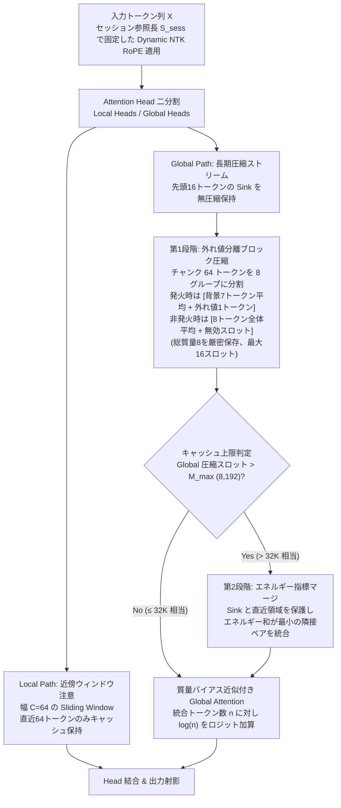
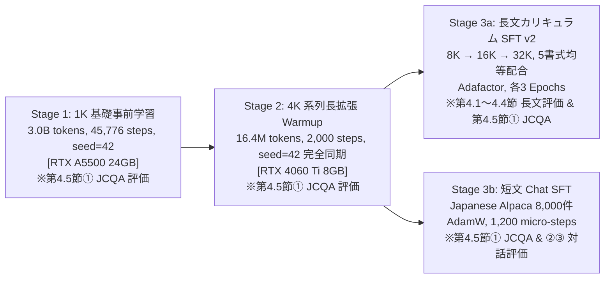
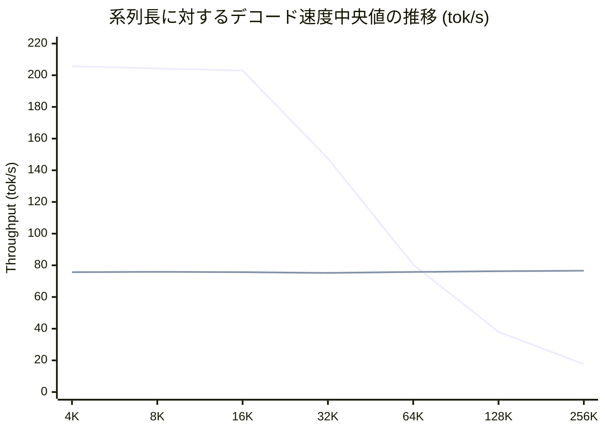

# AnchorMass: 表現空間の外れ値分離ブロック圧縮とエネルギー指標マージによる上限付きKVキャッシュ長文言語モデル

**AnchorMass: Bounded KV-Cache Long-Context Language Modeling via Outlier-Preserving Block Compression and Energy-Guided Merging**

- **ステータス**: Preprint / Technical Paper Draft (2026年10月17日)
- **対象モデル実装**: [`anchormass/model.py`](../anchormass/model.py)
  - 言語モデルクラス: [`AnchorMassForCausalLM`](../anchormass/model.py#L941-L1118)
  - 注意層クラス: [`AnchorMassAttention`](../anchormass/model.py#L176-L921)
- **比較対象モデル実装**: [`anchormass/standard_model.py`](../anchormass/standard_model.py)（標準 Transformer 言語モデルクラス: [`GPTLanguageModel`](../anchormass/standard_model.py#L232-L359)）
- **評価・再現スクリプト**: [`eval/long_context.py`](../eval/long_context.py), [`eval/commonsense.py`](../eval/commonsense.py), [`eval/robustness.py`](../eval/robustness.py), [`eval/dialogue_laaj.py`](../eval/dialogue_laaj.py)

---

## Abstract（要旨）

自己回帰型 Transformer 言語モデルにおいて、Key-Value（KV）キャッシュの消費メモリ量とデコード時の計算量は系列長に比例して増大する。本稿では、Global KV キャッシュのスロット数に上限を設けながら長文文脈を保持・想起するための注意機構 **AnchorMassAttention** を設計し、同一の 158.6M パラメータ構成を持つ標準 Transformer（以下 **Standard-150M**）との対照実験結果を報告する。

AnchorMassAttention は4つの要素から構成される。第一に、注意ヘッドを近傍ウィンドウ専用の Local Heads と長期圧縮ストリーム用の Global Heads に分割する。第二に、入力チャンクのサブグループごとに Value ベクトルの幾何学的外れ値スロットを分離し、残りを背景平均して総質量を厳密に保存する第1段階ブロック圧縮を行う。第三に、統合トークン数の対数バイアスをロジットに加算して重み減衰を補正する質量バイアス近似を導入する。第四に、Global 圧縮キャッシュが上限スロット数（$M_{\max}=8,192$）に達した際、先頭 Sink と直近領域を保護した上で、ノルムと対数質量の積で定義されるエネルギー指標の小さい隣接ペアから段階的に統合する第2段階キャッシュ管理を行う。

158.6M パラメータのチェックポイントペアを用いた 4K から 256K トークンの実測評価において、以下の利得、代償、および実験上の留意点が観測された（メモリ単位: $1\text{ MiB} = 2^{20}\text{ B}$, $1\text{ GiB} = 2^{30}\text{ B}$）。

1. **有界な KV キャッシュ容量とピーク VRAM の挙動**:
   Standard-150M の KV キャッシュサイズが 32K トークン時の 1,344 MiB から 256K トークン時の 10,752 MiB へと線形増加するのに対し、AnchorMass-150M は上限 $M_{\max} = 8,192$ スロットの設定により、別枠固定バッファを含めたモデル全体の総 KV キャッシュ容量を 32K から 256K の測定全域で **実測 258.58 MiB（純粋 BF16 構成時 173.27 MiB）に厳密に束縛** した。ただし、プロセス全体のピーク VRAM は 32K 時の 1.87 GiB から 256K 時の 4.95 GiB へ増加した。これは、評価時に両モデルが GPU 上に同時常駐していたこと、および各層の Dynamic NTK RoPE 位置テーブル（256K 時で 1.75 GiB）が系列長に応じて拡張されたことに起因する。
2. **実装パイプライン込みの推論速度と損益分岐点（推定値）**:
   Prefill 時間は、1,024 トークン刻みの逐次圧縮を伴う AnchorMass-150M の方が、一括 FlashAttention-2 [11] を用いる Standard-150M より 3.6〜12 倍遅い。デコード速度も 64K トークン以下では Standard-150M が高速である。一方、AnchorMass-150M のデコード速度中央値は 4K から 256K の全域で毎秒 75.2〜76.6 トークンと安定して推移し、128K および 256K において逆転した。なお、Prefill 遅延を相殺する概算損益分岐点は 128K で約 1,036 トークン、256K で約 603 トークン（実測中央値からの外挿推定値）であり、短出力タスクにおける総実行時間は Standard-150M の方が短い。
3. **言語モデリング・想起・短文推論の観測差**:
   先行文脈のない 1K トークンの言語モデリング（PPL）では Standard-150M が優位であったが、2K から 32K トークンの長文領域では AnchorMass-150M の方が低い PPL を示した（全6系列長 Holm 補正後 $p_{\text{Holm}} \le 0.0137$）。Passkey 想起テストでは 16K から 64K トークンで AnchorMass-150M の正答数が多く、8K 5書式汎化テスト（計150試行）では AnchorMass-150M が 134 問、Standard-150M が 130 問正解した（64K 以降は両モデルとも想起率が急減）。JCommonsenseQA 全検証セット（1,119問）の横断評価では、長文 SFT 後のモデルにおいて AnchorMass-150M が Standard-150M に対し +4.65 ポイントの有意差（$p = 0.00062$）を示した。なお、長文学習時のサンプル順序や訓練単位の違い、要素別アブレーションの未実施など実験上の制約があり、これらの観測差は本実装パイプラインにおける実測値として報告する。

---

## 1. Introduction（背景と検討課題）

長文脈を処理する自己回帰型 Transformer において、過去の全トークンに対する Key と Value を無圧縮で保持する標準キャッシュ方式は、系列長 $T$ に比例して KV キャッシュメモリとデコード時のメモリアクセス負荷を増大させる。

このキャッシュサイズを一定の予算 $M_{\max}$ 以下に制限するアプローチとして、先頭の Sink トークンや高スコアトークンのみを残して他を破棄する間引き方式（StreamingLLM [1]、H2O [2]、SnapKV [3]）と、近接・類似するトークンを重み付き平均などで統合するマージ方式（ToMe [4]、DMC [5]、CaM [6]）が提案されてきた。しかし、単純な破棄方式では予算を超えた過去文脈が完全に失われ、一様な平均化マージ方式では局所的な固有表現や数値情報が周囲の背景表現に埋没して鈍化する課題がある。また、KV キャッシュ圧縮が複数指示への追従性を不均一に劣化させる脆弱性も指摘されている（Chen et al. [19]）。

この課題に対し、本研究では2段階のアプローチをとる **AnchorMassAttention** を設計・実装した。第1段階のブロック圧縮では、Value ベクトル空間において平均との類似度が低い、またはノルムが大きい外れ値トークンを単独スロットとして保護し、残りの背景群のみを加重平均して総質量を保存する。第2段階のキャッシュ管理では、Global 圧縮キャッシュが上限 $M_{\max}$ スロットを超過した際に直近領域を保護しつつ、エネルギー指標の小さい隣接ペアから段階的に統合する。

本稿の目的は、AnchorMassAttention の数理アルゴリズムと前提条件を明示した上で、158.6M パラメータ構成の Standard-150M との対照比較を通じ、キャッシュ上限抑制や超長文デコード速度の維持といった利得、Prefill 遅延や位置埋め込みキャッシュ拡張に伴うメモリ増加といった代償、および統計的制約を客観的に記録することである。

---

## 2. Architecture: AnchorMassAttention の設計と定式化

AnchorMassAttention を組み込んだ言語モデル **AnchorMass-150M**（略称 **AM-150M**）は、Pre-RMSNorm [12] と SwiGLU FFN [13] で構成される 14 層の Transformer であり、自己注意層を [`AnchorMassAttention`](../anchormass/model.py#L176-L921) に置き換えている。処理の全体像を図1に示す。



### 2.1 Local / Global Attention Head 分割と Dynamic NTK RoPE
各層の全 $H=12$ 個の Query Head および $H_{kv}=12$ 個の KV Head を 6 個ずつに等分する。
- **Local Heads ($H_{\text{loc}}=6$)**: チャンク幅 $C=64$ のスライディングウィンドウ注意 [7, 8] を計算し、推論時は直近 $C=64$ トークンの KV キャッシュのみを保持する。
- **Global Heads ($H_{\text{glob}}=6$)**: 先頭 $S_{\text{sink}} = 16$ トークンを Attention Sink [1] として別枠で無圧縮保持し、それ以降のトークン列を後述の圧縮機構（上限 $M_{\max} = 8,192$ スロット）へ送る。

**Dynamic NTK RoPE の数理定義とセッション参照長 $S_{\text{sess}}$ の統一**:
プロンプト長を $P$、最大生成長を $L_{\text{gen}}$、RoPE スケーリング基底の決定に用いるセッション参照長を $S_{\text{sess}}$ とする。本実装（[`RotaryEmbedding._compute_inv_freq_for_len`](../anchormass/model.py#L110-L118)）では、基準系列長 $L_{\text{orig}} = 1,024$ を超える $S_{\text{sess}}$ に対し、長さ比率 $s = S_{\text{sess}} / L_{\text{orig}}$ を用いた以下の無パラメータ（parameter-free）NTK スケーリング式 [9, 10] により回転基底 $\theta'(S_{\text{sess}})$ を決定する：
$$\theta'(S_{\text{sess}}) = \theta \cdot \left(\frac{\max(S_{\text{sess}},\, L_{\text{orig}})}{L_{\text{orig}}}\right)^{\frac{d}{d-2}} \qquad (\theta = 10000,\; L_{\text{orig}} = 1024,\; d = 64)$$
生成中の過去 Key と新規 Query の位相不整合を防ぐため、推論開始時にモデルレベルのメソッド [`model.set_session_length(S_sess)`](../anchormass/model.py#L960-L962)（各層注意機構の [`RotaryEmbedding.set_session_length`](../anchormass/model.py#L128-L135) へ内部委譲）を呼び出し、長さ $L_{\text{cache}} = \max(S_{\text{sess}} + 128,\, 4096)$ の正弦・余弦テーブル（`cos_cached`, `sin_cached`）を事前生成する。評価スイートでは $S_{\text{sess}} = P$（$+128$ トークンのマージン内）で事前確保されるため、デコード中に回転基底が変化することはない（第3.3節で実測検証）。

なお、RoPE 角度計算は数値精度を保つため FP32 で実行される。評価時の `torch.autocast(device_type="cuda", dtype=torch.bfloat16)` 条件下では、`nn.RMSNorm` の出力が FP32 となり `self.rope` が FP32 の `cos, sin` を返すため、回転後の Key キャッシュは FP32（4 bytes/要素）として保持される（純粋 BF16 構成時は Key も BF16 2 bytes で保持可能）。

### 2.2 第1段階：Value 外れ値分離を伴うブロック圧縮
Sink 以降のトークン列は、関数 [`_selective_block_compress`](../anchormass/model.py#L228-L345) によりブロック長 $C=64$ ごとにサイズ 8 のサブグループ 8 個へと分割される。各サブグループ内のトークン集合 $i \in \{1, \dots, 8\}$（初期質量 $n_i = 1$）に対し、以下の手順で処理を行う。

1. **類似度と相対ノルムの算出**: 初期加重平均 $\bar{\mathbf{v}}_{\text{init}} = \frac{\sum_i n_i \mathbf{v}_i}{\sum_i n_i}$ に対するコサイン類似度 $\text{sim}_i$ と平均ノルム比 $r_i$ を全グローバルヘッドで計算・平均する。
2. **候補選択と発火判定**: 方向乖離が最大となる $i^* = \arg\min_i \overline{\text{sim}}_i$ を唯一の分離候補とし、発火フラグ $E = \mathbb{I}[(\min_i \overline{\text{sim}}_i < 0.85) \lor (\max_i \overline{r}_i > 2.0)]$ を判定する。
3. **背景平均と外れ値の出力**:
   - $E=1$ の場合：候補 $i^*$ を独立スロット（質量1）として分離し、残る 7 トークンを加重平均して背景スロット（質量7）とする。
   - $E=0$ の場合：8 トークンすべてを加重平均して背景スロット（質量8）とし、外れ値スロットは無効（質量0）とする。
   背景スロットの Key には、位相干渉を防ぐため背景集合の末尾トークンの Key ベクトル（アンカー）を採用する。

```python
# アルゴリズム1: 第1段階サブグループ圧縮の疑似コード (anchormass/model.py L299-L345 準拠)
# 入力: サブグループ内の Key kg [H, 8, D], Value vg [H, 8, D], 質量 ng [H, 8] (初期値 1)
v_init_mean = (vg * ng.unsqueeze(-1)).sum(dim=1, keepdim=True) / ng.sum(dim=1, keepdim=True)
sim_mean = cosine_similarity(vg, v_init_mean).mean(dim=0)
rel_norm = (vg.norm(dim=-1) / vg.norm(dim=-1).mean(dim=1, keepdim=True)).mean(dim=0)

minsim, i_star = sim_mean.min(dim=0)
emit = (minsim < 0.85) or (rel_norm.max(dim=0)[0] > 2.0)

if emit:
    bg_idx = [i for i in range(8) if i != i_star]
    k_ex, v_ex, n_ex = kg[:, i_star], vg[:, i_star], ng[:, i_star]
else:
    bg_idx = list(range(8))
    k_ex, v_ex, n_ex = zeros_like(kg[:, 0]), zeros_like(vg[:, 0]), zeros_like(ng[:, 0])

n_bg = ng[:, bg_idx].sum(dim=1)
v_bg = (vg[:, bg_idx] * ng[:, bg_idx].unsqueeze(-1)).sum(dim=1) / n_bg.unsqueeze(-1)
k_bg = kg[:, max(bg_idx)]  # 背景末尾位置のKeyをアンカー採用
```

これにより、外れ値フラグの状態にかかわらずサブグループ内のトークン欠落は一切発生せず、総質量 $\sum_{i=1}^8 n_i = n_{\text{bg}} + n_{\text{ex}} = 8$ が厳密に保存される。

> **幾何学的外れ値と意味的重要情報の峻別**:
> 本検出器は Value ベクトル平均からの幾何学的乖離やノルムを捉えるヒューリスティックであり、文脈上の意味的重要度を直接識別するものではない。1サブグループから分離される外れ値は高々1トークンである点に留意が必要である。

### 2.3 質量バイアス近似付き Global Attention
各キャッシュスロット $j$ が統合した元トークン数（質量 $n_j \ge 1$）を反映させるため、ロジットに対数質量 $\log(n_j)$ を加算する。
$$\text{Attention}(\mathbf{q}_i, \mathbf{K}, \mathbf{V}, \mathbf{n}) = \text{softmax}\!\left(\frac{\mathbf{q}_i \mathbf{K}^\top}{\sqrt{d_k}} + \log(\mathbf{n}) + \mathbf{M}_{\text{causal}}\right)\mathbf{V}$$
因果マスク $\mathbf{M}_{\text{causal}}$ は、圧縮スロット $j$ が包含する元トークン群の最大位置がクエリ位置 $i$ 以下の場合のみ 0、未来位置を含む場合は $-\infty$ を与える。Key が完全に一致しない実際のトークン列において、この対数加算は統合スロットの注意重みが単一トークン相当へ減衰することを防ぐ粗視化近似として機能する。

### 2.4 第2段階：エネルギー指標に基づくキャッシュ上限管理
Global 圧縮キャッシュ（`g_sum_k`, `g_sum_v`, `g_n`）が上限 $M_{\max} = 8,192$ スロットを超過した際、関数 [`_enforce_budget`](../anchormass/model.py#L458-L604) により以下の削減処理を行う（Sink 16 スロット、Local 64 トークン、端数バッファは別枠固定）。
1. **保護領域の除外**: 先頭 16 スロットの Sink 領域と、末尾の直近 $M_{\max} / 4$ スロットを再マージ対象から除外する。
2. **最小エネルギー隣接ペアの選択**: 中間スロット $j$ に対し、指標 $e_j = \frac{1}{H_{\text{glob}}}\sum_h \|\mathbf{v}_{h,j}\|_2 \log(1 + n_{h,j})$ を計算し、隣接ペア和 $e_{2k} + e_{2k+1}$ が小さい下位ペアを選択する。
3. **ペア統合**: 各ヘッドのスコア比率で加重平均 Value ベクトルを求め、スコアが高い側の Key を採用して1スロットに統合する。質量は両スロットの和とする。

---

## 3. Experimental Setup（158.6M 対照実験の構成・統制条件・評価プロトコル）

### 3.1 モデル仕様とハードウェア環境
両モデルは語彙数 28,000、層数 14、隠れ層次元 768、FFN 次元 2,560、ヘッド数 12 で完全に共通しており、総パラメータ数はともに 158,635,776（158.6M）である。
- **基礎事前学習環境**: NVIDIA RTX A5500（VRAM 24.0 GiB）
- **追加学習・8GB 検証環境**: NVIDIA GeForce RTX 4060 Ti（VRAM 8.0 GiB）
- **超長文評価環境**: NVIDIA RTX 6000 Ada Generation（VRAM 47.4 GiB）

| 項目 | 標準 Transformer (`Standard-150M`) | AnchorMass (`AnchorMass-150M`) |
| :--- | :---: | :---: |
| **総パラメータ数** | **158,635,776** | **158,635,776** |
| **層数 / 隠れ層次元 / FFN次元** | 14層 / 768 / 2,560（SwiGLU [13]） | 14層 / 768 / 2,560（SwiGLU [13]） |
| **Attention Heads / KV Heads** | 12 / 12（Full Causal SDPA [11]） | 12 / 12（Local 6 ＋ Global 6 に等分） |
| **位置埋め込み** | Dynamic NTK RoPE [9, 10]（$\theta=10000$） | Dynamic NTK RoPE [9, 10]（$\theta=10000$） |
| **内部ブロック圧縮** | なし（全トークン保持） | チャンク幅 64、8 グループ、外れ値閾値 0.85 |
| **KV キャッシュ構成と上限** | 制限なし（系列長 $P$ に比例） | Global 圧縮上限 $M_{\max}=8,192$ スロット<br/>＋別枠固定（Sink 16・Local 64・端数最大48） |

---

### 3.2 学習パイプラインの全ステージ構成
本実験で用いた各チェックポイントは以下の3段階のパイプラインで構築した。評価用未見コーパス `val.bin`（1,008,089 トークン）はすべての学習データと厳密に分離されている。



1. **Stage 1：1K 基礎事前学習**: コーパス `part_01.bin`〜`part_03.bin`（計 3.0B トークン）を用い、系列長 1,024、実効バッチサイズ 64、45,776 ステップで学習（AdamW, WSD スケジューラ）。
2. **Stage 2：4K 系列長拡張 Warmup**: Stage 1 重みを初期値とし、`part_04.bin` から系列長 4,096 をサンプリング。独立した乱数生成器を持つ `PrefetchDataStream`（シード 42）により全 2,000 ステップの投入順序は完全同期。未見検証 PPL は Standard-150M が 17.37、AnchorMass-150M が 16.97。
3. **Stage 3a：長文カリキュラム SFT v2**: Stage 2 重みを初期値とし、`part_04.bin` を背景に 8K（300件）、16K（200件）、32K（200件）のパスキー抽出データを生成（データ作成日に基づく決定論的タイムスタンプシード `seed=20261016`、探索・選別なしの単一生成、5書式均等割付）。Adafactor [14] で各 3 エポック学習。
4. **Stage 3b：短文対話 Chat SFT**: Stage 2 重みを初期値とし、`japanese_alpaca_data` 8,000 件で AdamW 1,200 マイクロステップ学習。

---

### 3.3 評価プロトコルと計測手順
公正な対照評価を行うため、以下の測定統制を実施した。
1. **RoPE セッション長の事前確定とデコード中の基底不変性**: 評価スクリプトでは各試行開始時にプロンプト長 $P$ をセッション参照長 $S_{\text{sess}} = P$ として [`model.set_session_length(P)`](../anchormass/model.py#L960-L962) を呼び出し、長さ $L_{\text{cache}} = \max(P + 128, 4096)$ の FP32 テーブルを事前生成する。これにより長文デコード中に基底が一切変化しないことをビット単位で確認した。また、4K トークンにおける一括 Prefill とチャンク分割 Prefill の出力ロジット平均コサイン類似度は `0.999959`、Top-1 一致率は `99.32%` であった（詳細ログは [`logs/supp_eval_ablation_and_jcqa.json`](../logs/supp_eval_ablation_and_jcqa.json) に収録）。
2. **長系列 PPL の同一アンカー固定評価**: 未見コーパスから抽出した 10 個の固定アンカー位置について、常に同一の末尾 1,024 トークン（計 10,240 トークン）に対する対数尤度を測定し、対応ありブートストラップ 95% 信頼区間および Holm 補正付き対応あり Wilcoxon 検定を実施する。
3. **想起採点基準**: Greedy デコード（最大 15 トークン）を用い、先頭数値列と 4 桁正解パスキーの完全一致を正答とする。
4. **Prefill パイプライン条件**: 48GB 環境において、Standard-150M は一括 FlashAttention-2 [11]、AnchorMass-150M は 1,024 トークン刻みのチャンク処理を適用する。
5. **計測順序とメモリ計測**: ウォームアップ後、キャッシュクリアを挟んで両モデルを交互に実行し 15 試行の中央値を記録する。KV キャッシュ容量は全テンソルのバイト数を再帰合算して計測する。

---

## 4. Empirical Results（実験結果と観測された限界）

### 4.1 システムプロファイル：KV キャッシュ量、ピーク VRAM、推論速度、および損益分岐点
Stage 3a 重みを用い、RTX 6000 Ada 上で測定した推論プロファイル実測値を表1に示す。

#### 表1: 系列長に応じた推論プロファイル実測値（メモリ単位: $1\text{ MiB}=2^{20}\text{ B}$, $1\text{ GiB}=2^{30}\text{ B}$）
| 系列長 | Standard-150M 総KVキャッシュ (Peak VRAM) | **AnchorMass-150M 総KVキャッシュ (Peak VRAM)** | Prefill 時間中央値 (Standard vs AM) | デコード速度中央値 (Standard vs **AM**) |
| :--- | :---: | :---: | :---: | :---: |
| **4,096** | 168 MiB (0.91 GiB) | **36 MiB** (1.04 GiB) | **0.01 s** vs 0.12 s | **205.7** vs 75.7 tok/s |
| **8,192** | 336 MiB (1.22 GiB) | **67 MiB** (0.93 GiB) | **0.03 s** vs 0.24 s | **204.3** vs 75.9 tok/s |
| **16,384** | 672 MiB (1.83 GiB) | **131 MiB** (1.24 GiB) | **0.07 s** vs 0.51 s | **202.9** vs 75.7 tok/s |
| **32,768** | 1,344 MiB (3.06 GiB) | **258 MiB** (1.87 GiB) | **0.23 s** vs 1.19 s | **147.5** vs 75.2 tok/s |
| **65,536** | 2,689 MiB (5.51 GiB) | **259 MiB** (2.32 GiB) | **0.78 s** vs 6.26 s | **80.5** vs 75.8 tok/s |
| **131,072** | 5,377 MiB (10.42 GiB) | **259 MiB** (3.20 GiB) | **2.73 s** vs 16.42 s | 38.0 vs **76.3 tok/s** |
| **262,144** | 10,752 MiB (20.23 GiB) | **259 MiB** (4.95 GiB) | **10.18 s** vs 36.59 s | 17.6 vs **76.6 tok/s** |



**実測結果の分析**:
1. **総 KV キャッシュ容量とデータ型**:
   Standard-150M の KV キャッシュサイズが 256K トークンで 10,752 MiB に達するのに対し、AnchorMass-150M は Global 圧縮キャッシュ上限（$M_{\max}=8,192$ スロット）と別枠固定バッファ（Sink 16、Local 64、端数 48 トークン）により、32K 以降の総 KV キャッシュ容量を **実測 258.58 MiB（四捨五入 259 MiB）** に厳密に束縛した。本評価スイートの CUDA `autocast`（BF16）条件下では、Key キャッシュが FP32（4 bytes）、Value キャッシュが BF16（2 bytes）、質量テンソルが FP32（4 bytes）で保持される。なお、Key も BF16 で保持する純粋 BF16 構成時の総容量は **173.27 MiB** となる（詳細なテンソル内訳は Appendix A 参照）。
2. **ピーク VRAM の挙動（両モデル常駐と RoPE テーブル拡張）**:
   表1の Peak VRAM は、両モデルが GPU 上に同時常駐した状態で計測したプロセス全体の最大割り当て量である。AnchorMass-150M 実行時の Peak VRAM が 32K 時の 1.87 GiB から 256K 時の 4.95 GiB へ増加している主因は、全 14 層がそれぞれ長さ $P + 128$ の FP32 RoPE テーブル（256K 時で 1.75 GiB）を重複生成・保持しているためである（4K 時の 1.04 GiB が 8K 時の 0.93 GiB より大きいのは初回一時バッファ確保による）。
3. **推論速度とエンドツーエンド損益分岐点（推定値）**:
   Prefill 時間は一括 FlashAttention-2 を用いる Standard-150M が全系列長で 3.6〜12 倍高速であり、64K 以下のデコード速度も優位である。128K および 256K では AnchorMass-150M のデコード速度が逆転するが、表1の中央値から外挿した Prefill 遅延相殺の **概算損益分岐点（推定値）は 128K で約 1,036 トークン、256K で約 603 トークン** であり、短出力タスクにおける総実行時間は Standard-150M の方が短い。

---

### 4.2 長系列 Perplexity 評価（10固定アンカー・ブートストラップ・多重比較補正）
未見コーパス `val.bin` から抽出した 10 個の固定アンカー位置について、常に同一の末尾 1,024 トークン（計 10,240 トークン）に対する言語モデリング性能を測定した結果を表2に示す（詳細ログは [`logs/supp_eval_ablation_and_jcqa.json`](../logs/supp_eval_ablation_and_jcqa.json) に収録）。

#### 表2: 系列長ごとの言語モデリング PPL、アンカー間平均 Loss ± 標準偏差、および対応あり検定（$n=10$ アンカー、全6系列長 Holm 補正付き）
| 系列長 (先行文脈長) | Standard-150M<br/>合算 PPL `[95% Boot CI]`<br/>*(アンカー平均 Loss ± SD)* | **AnchorMass-150M**<br/>**合算 PPL `[95% Boot CI]`**<br/>*(アンカー平均 Loss ± SD)* | 観測 PPL 差 $\Delta$<br/>`[対応95% Boot CI]` | AM 優位アンカー数<br/>(Wilcoxon $p$ / 6系列長 $p_{\text{Holm}}$ / 対応 $t$ 検定 $p_t$) |
| :--- | :---: | :---: | :---: | :---: |
| **1,024 (先行 0)** | **26.49** `[13.36, 43.20]`<br/>*(3.277 ± 1.014)* | 36.91 `[22.16, 53.59]`<br/>*(3.609 ± 0.764)* | +10.42 `[+7.79, +13.12]`<br/>(**Standard 低PPL**) | 0 / 10 勝<br/>($p_{\text{wilcox}}=0.0020$, $p_{\text{Holm}}=0.0117$, $p_t=0.0046$) |
| **2,048 (先行 1K)** | 22.19 `[11.39, 35.59]`<br/>*(3.100 ± 1.003)* | **17.95** `[9.68, 27.78]`<br/>*(2.887 ± 0.923)* | **-4.24** `[-7.95, -1.63]`<br/>(**AnchorMass 低PPL**) | **9 / 10 勝**<br/>($p_{\text{wilcox}}=0.0039$, $p_{\text{Holm}}=0.0117$, $p_t=5.8\times 10^{-5}$) |
| **4,096 (先行 3K)** | 21.67 `[10.84, 34.96]`<br/>*(3.076 ± 1.017)* | **18.99** `[9.96, 29.69]`<br/>*(2.944 ± 0.940)* | **-2.68** `[-5.61, -0.69]`<br/>(**AnchorMass 低PPL**) | **9 / 10 勝**<br/>($p_{\text{wilcox}}=0.0137$, $p_{\text{Holm}}=0.0137$, $p_t=0.0045$) |
| **8,192 (先行 7K)** | 28.32 `[13.83, 47.08]`<br/>*(3.344 ± 1.076)* | **21.47** `[11.54, 33.73]`<br/>*(3.067 ± 0.948)* | **-6.85** `[-14.26, -2.18]`<br/>(**AnchorMass 低PPL**) | **9 / 10 勝**<br/>($p_{\text{wilcox}}=0.0039$, $p_{\text{Holm}}=0.0117$, $p_t=0.0016$) |
| **16,384 (先行 15K)** | 50.03 `[22.50, 90.18]`<br/>*(3.913 ± 1.228)* | **25.61** `[13.47, 41.72]`<br/>*(3.243 ± 0.987)* | **-24.43** `[-51.43, -8.16]`<br/>(**AnchorMass 低PPL**) | **10 / 10 勝**<br/>($p_{\text{wilcox}}=0.0020$, $p_{\text{Holm}}=0.0117$, $p_t=0.00067$) |
| **32,768 (先行 31K)** | 81.08 `[37.47, 147.44]`<br/>*(4.395 ± 1.186)* | **34.17** `[17.71, 55.41]`<br/>*(3.531 ± 0.983)* | **-46.91** `[-95.64, -18.49]`<br/>(**AnchorMass 低PPL**) | **10 / 10 勝**<br/>($p_{\text{wilcox}}=0.0020$, $p_{\text{Holm}}=0.0117$, $p_t=0.00016$) |

先行文脈のない 1,024 トークンでは全 10 アンカーで Standard-150M の Loss が低かったが、先行文脈が付与される 2,048〜32,768 トークンでは 9〜10 アンカーで AnchorMass-150M の Loss が低く、全 6 系列長に対する Holm 補正後も $p_{\text{Holm}} \le 0.0137$ となり一貫した差が観測された。

---

### 4.3 Needle-in-a-Haystack 長文想起評価と書式別評価
パスキー想起テスト（Needle-in-a-Haystack [15, 16]）の結果を表3および表4に示す。

#### 表3: 系列長別の Needle 完全想起率と平均一致桁数（各系列長 15 試行）
| 系列長 | Standard-150M 完全想起率 (一致桁) | **AnchorMass-150M 完全想起率 (一致桁)** | 正答数差 (全15試行) |
| :--- | :---: | :---: | :--- |
| **4K / 8K** | 93.3% (14/15) / 80.0% (12/15) | **100.0% (15/15)** / **80.0% (12/15)** | 4K で +1問、8K で同数 |
| **16K** | 66.7% (10/15, 3.13桁) | **86.7% (13/15, 3.73桁)** | AnchorMass が +3問 |
| **32K (学習上限)** | 46.7% (7/15, 2.13桁) | **86.7% (13/15, 3.73桁)** | AnchorMass が +6問 |
| **64K (2倍外挿)** | 6.7% (1/15, 0.53桁) | **33.3% (5/15, 1.87桁)** | AnchorMass が +4問（両者低下） |
| **128K / 256K** | 0.0% (0/15) / 0.0% (0/15) | **6.7% (1/15)** / 0.0% (0/15) | 両者 0〜1問に低下 |

#### 表4: 8K トークンにおける学習済み 5 書式の新規事例一般化評価（各書式 30 試行、計 150 試行）
| テンプレート書式 | Standard-150M | **AnchorMass-150M** | 書式別の正答数差 |
| :--- | :---: | :---: | :--- |
| 接頭辞あり（`original_prefix`） | 90.0% (27/30, 3.90桁) | **100.0% (30/30, 4.00桁)** | AnchorMass が +3問 |
| 接頭辞なし（`original_no_prefix`） | **90.0% (27/30, 3.70桁)** | 86.7% (26/30, 3.73桁) | **Standard が +1問** |
| 言い換え形式（`lexical_paraphrase`） | **90.0% (27/30, 3.73桁)** | 86.7% (26/30, 3.83桁) | **Standard が +1問** |
| メモ形式（`memo_format`） | 73.3% (22/30, 3.63桁) | **80.0% (24/30, 3.63桁)** | AnchorMass が +2問 |
| 対話形式（`dialogue_format`） | 90.0% (27/30, 3.73桁) | **93.3% (28/30, 3.87桁)** | AnchorMass が +1問 |
| **全 5 書式合計 (150試行)** | 86.7% (130/150, 3.74桁) | **89.3% (134/150, 3.81桁)** | 全体で AnchorMass が +4問 |

**結果の解釈と適用範囲の区別**:
16K〜64K トークンでは AnchorMass-150M の正答数が多かったが、64K 以降では両モデルともに想起率が急減した。したがって、**「256K トークンまで総 KV キャッシュ容量 258.58 MiB（純粋 BF16 構成時 173.27 MiB）の下で OOM を起こさずに推論を実行できる性質」** と **「長距離の情報を正確に想起できる有効コンテキスト長（現状では 32K まで高水準、64K で急減）」** は明確に区別される必要がある。また、8K 5書式汎化テストでは 3 書式で AnchorMass-150M が上回り、2 書式では Standard-150M が上回っており、150 試行全体での差は 4 問にとどまる。未知の質問書式に対するゼロショット汎化や複数指示追従性（Chen et al. [19]）は今後の課題である。

---

### 4.4 第2段階キャッシュ管理ポリシーの比較検証（8K・5深度・各条件 $n=30$ 試行）
同一の AnchorMass-150M チェックポイント（Stage 3a）において、[`_enforce_budget`](../anchormass/model.py#L458-L604) に実装されている 5 種類のキャッシュ管理ポリシーを切り替えた対照実験の結果を表 5 に示す（系列長 8K、書式 `original_no_prefix`、同一課題 $n=30$ 試行、詳細ログは [`logs/supp_eval_ablation_and_jcqa.json`](../logs/supp_eval_ablation_and_jcqa.json) に記録）。

#### 表5: 第2段階キャッシュ管理5ポリシーの対応あり比較（系列長 8K、5深度合計 $n=30$ 試行）
| キャッシュ予算 (8K比圧縮率) | **`adaptive` (提案)** | `score_merge` | `uniform_merge` | `priority` (スコア選別) | `fifo` (先頭Sink+直近保持) |
| :--- | :---: | :---: | :---: | :---: | :---: |
| **512 slots (16倍圧縮)** | **76.7% (23/30)**<br/>95% CI: `[59.1, 88.2]%`<br/>一致桁: **3.67 / 4.0** | 20.0% (6/30)<br/>95% CI: `[9.5, 37.3]%`<br/>一致桁: 0.90<br/>($p=7.6\times 10^{-5}$, $p_{\text{Holm}}=3.8\times 10^{-4}$) | 20.0% (6/30)<br/>95% CI: `[9.5, 37.3]%`<br/>一致桁: 0.87<br/>($p=7.6\times 10^{-5}$, $p_{\text{Holm}}=3.8\times 10^{-4}$) | 50.0% (15/30)<br/>95% CI: `[33.2, 66.8]%`<br/>一致桁: 2.57<br/>($p=0.039$, $p_{\text{Holm}}=0.039$, $p_{\text{Bonf}}=0.46$) | 20.0% (6/30)<br/>95% CI: `[9.5, 37.3]%`<br/>一致桁: 0.90<br/>($p=7.6\times 10^{-5}$, $p_{\text{Holm}}=3.8\times 10^{-4}$) |
| **256 slots (32倍圧縮)** | **93.3% (28/30)**<br/>95% CI: `[78.7, 98.2]%`<br/>一致桁: **3.87 / 4.0** | 16.7% (5/30)<br/>95% CI: `[7.3, 33.6]%`<br/>一致桁: 0.80<br/>($p=2.4\times 10^{-7}$, $p_{\text{Holm}}=2.9\times 10^{-6}$) | 20.0% (6/30)<br/>95% CI: `[9.5, 37.3]%`<br/>一致桁: 0.90<br/>($p=4.8\times 10^{-7}$, $p_{\text{Holm}}=5.3\times 10^{-6}$) | 23.3% (7/30)<br/>95% CI: `[11.8, 40.9]%`<br/>一致桁: 1.53<br/>($p=9.5\times 10^{-7}$, $p_{\text{Holm}}=8.6\times 10^{-6}$) | 20.0% (6/30)<br/>95% CI: `[9.5, 37.3]%`<br/>一致桁: 0.90<br/>($p=4.8\times 10^{-7}$, $p_{\text{Holm}}=5.3\times 10^{-6}$) |
| **128 slots (64倍圧縮)** | **70.0% (21/30)**<br/>95% CI: `[52.1, 83.3]%`<br/>一致桁: **3.37 / 4.0** | 0.0% (0/30)<br/>95% CI: `[0.0, 11.4]%`<br/>一致桁: 0.13<br/>($p=9.5\times 10^{-7}$, $p_{\text{Holm}}=8.6\times 10^{-6}$) | 0.0% (0/30)<br/>95% CI: `[0.0, 11.4]%`<br/>一致桁: 0.10<br/>($p=9.5\times 10^{-7}$, $p_{\text{Holm}}=8.6\times 10^{-6}$) | 10.0% (3/30)<br/>95% CI: `[3.5, 25.6]%`<br/>一致桁: 1.03<br/>($p=1.2\times 10^{-4}$, $p_{\text{Holm}}=3.8\times 10^{-4}$) | 0.0% (0/30)<br/>95% CI: `[0.0, 11.4]%`<br/>一致桁: 0.10<br/>($p=9.5\times 10^{-7}$, $p_{\text{Holm}}=8.6\times 10^{-6}$) |

- **分析と解釈**:
  1. fifo、score_merge、uniform_merge が記録した正答は、その全数が最も末尾に近い深度 0.9 のみで発生し、中盤以前の深度（depth $\le 0.7$、24 試行）では正答数が 0 であった。これに対し、先頭 Sink と直近領域を保護し中間領域の低エネルギーペアを統合する adaptive は、中盤以前の深度でも 128 スロットで 16 勝（66.7%）、256 スロットで 22 勝（91.7%）、512 スロットで 18 勝（75.0%）の想起に成功した。
  2. 主基準である Holm 順次降順補正の下では 12 条件すべてで $p_{\text{Holm}} < 0.05$（うち 11 条件で $p_{\text{Holm}} \le 3.8 \times 10^{-4}$）を満たした。ただし、512 スロットにおける adaptive と priority の比較は保守的な Bonferroni 感度分析では $p_{\text{Bonf}} = 0.46$ となり境界的な差にとどまる。
  3. 512 スロット（76.7%）より 256 スロット（93.3%）で正解率が高かった点については、両予算間の 30 問が独立サンプルであり両側 Fisher 検定で $p = 0.146$（95% 信頼区間も重複）となるため、サンプリング変動の範囲内と解釈される。
  4. なお、本比較はリポジトリ内実装オプション間の比較であり、各手法専用に学習したモデル同士の比較ではない。

---

### 4.5 短文常識推論（JCommonsenseQA）と探索的対話品質評価

#### ① JCommonsenseQA 全4ステージ横断・対応あり客観評価（$N=1,119$ 全問 ＆ 先頭 $N=200$ 問）
JGLUE v1.3 JCommonsenseQA [17] に対する全 4 学習ステージの横断評価結果を表 6 に示す。統計的有意性の主判定には対応あり両側厳密 McNemar 検定を採用している。

#### 表6: 全4学習ステージにおける JCommonsenseQA 正解率と対応あり McNemar 検定（$N=1,119$ 全問 ＆ 先頭 $N=200$ 問）
| 学習ステージ (チェックポイント) | 評価対象 | Standard-150M 正解率 (95% CI) | **AnchorMass-150M 正解率 (95% CI)** | 正解率差 $\Delta$ (漸近Wald 95% CI) | 対応あり内訳 `(両正/Standardのみ/AMのみ/両誤)` | 厳密 McNemar $p$ 値 |
| :--- | :---: | :---: | :---: | :---: | :---: | :---: |
| **Stage 1: 1K 基礎事前学習**<br/>(`tf_1_150M.pt` vs `lb_11_150M.pt`) | **全 1,119 問**<br/>*(先頭 200 問)* | 56.03% (`627/1119`) `[53.1, 58.9]%`<br/>*55.00% (`110/200`)* | **57.91%** (`648/1119`) `[55.0, 60.8]%`<br/>***57.50%** (`115/200`)* | **+1.88pt** `[-0.41, +4.17]%`<br/>*(+2.50pt)* | `552 / 75 / 96 / 396`<br/>*(`99 / 11 / 16 / 74`)* | $p = 0.126$ (有意差未検出)<br/>*($p = 0.442$)* |
| **Stage 2: 4K Context Warmup**<br/>(`*_4k_warmup.pt`, seed=42 同期) | **全 1,119 問**<br/>*(先頭 200 問)* | 54.96% (`615/1119`) `[52.0, 57.9]%`<br/>*56.00% (`112/200`)* | **57.37%** (`642/1119`) `[54.5, 60.2]%`<br/>***57.00%** (`114/200`)* | **+2.41pt** `[+0.06, +4.77]%`※<br/>*(+1.00pt)* | `538 / 77 / 104 / 400`<br/>*(`96 / 16 / 18 / 70`)* | $p = 0.053$ (有意差未検出)<br/>*($p = 0.864$)* |
| **Stage 3a: 32K 長文 SFT v2**<br/>(`v2/*_32k_sft.pt`) | **全 1,119 問**<br/>*(先頭 200 問)* | 52.73% (`590/1119`) `[49.8, 55.6]%`<br/>*50.50% (`101/200`)* | **57.37%** (`642/1119`) `[54.5, 60.2]%`<br/>***58.00%** (`116/200`)* | **+4.65pt** `[+2.04, +7.26]%`<br/>*(+7.50pt)* | `504 / 86 / 138 / 391`<br/>*(`88 / 13 / 28 / 71`)* | **$p = 0.00062$** (有意差あり)<br/>*($p = 0.028$)* |
| **Stage 3b: 短文 Chat SFT**<br/>(`*_chat_sft.pt`) | **全 1,119 問**<br/>*(先頭 200 問)* | 56.03% (`627/1119`) `[53.1, 58.9]%`<br/>*57.00% (`114/200`)* | **56.39%** (`631/1119`) `[53.5, 59.3]%`<br/>***57.00%** (`114/200`)* | **+0.36pt** `[-1.89, +2.60]%`<br/>*(0.00pt)* | `547 / 80 / 84 / 408`<br/>*(`101 / 13 / 13 / 73`)* | $p = 0.815$ (有意差未検出)<br/>*($p = 1.000$)* |

※ Stage 2 は漸近 Wald 95% CI が 0 をわずかに超える一方、厳密 McNemar 検定（$p = 0.053$）および連続性補正付き CI では 0 を跨ぐため保守的に「有意差未検出」と判定している。

Stage 1、Stage 2、Stage 3b では両モデル間に有意な性能差は検出されなかった（非劣性の証明ではない点に留意）。一方、長文抽出 SFT（Stage 3a）後において Standard-150M の正解率が 52.73% へ低下したのに対し、AnchorMass-150M は 57.37% を維持し、有意差が検出された（$p = 0.00062$）。Local Head（直近 64 トークンを無圧縮処理）と Global Head の分離が短文知識の保持に寄与した可能性が示唆される。

#### ② 短文対話の探索的 LLM-as-a-Judge 評価（Stage 3b: Chat SFT 重み・50問）
短文対話の定性的挙動を確認する探索的評価として、事実知識 25 問と対話・論理説明 25 問の計 50 問に対し、`Qwen/Qwen3-4B-Instruct` による位置反転検証 LLM-as-a-Judge（LaaJ）[18] を実施した結果を表 7 に示す（採点ルーブリックおよび内訳詳細は Appendix B 参照）。

#### 表7: 短文対話50問の探索的評価結果（Qwen3-4B 位置反転検証 LaaJ）
| 評価カテゴリ区分 (全50問) | Standard 優位 (Win) | **AnchorMass 優位 (Win)** | 引き分け・順序不一致 (TIE) | 平均スコア (10点満点: Standard vs AnchorMass) |
| :--- | :---: | :---: | :---: | :---: |
| **全 50 問合計** | 2 件 (4.0%) | **11 件 (22.0%)** | **37 件 (74.0%)** | 2.22 点 vs **2.50 点** |
| ├ **事実知識カテゴリ（Q1〜Q25, 25問）** | **2 件 (8.0%)** | 0 件 (0.0%) | **23 件 (92.0%)** | **2.82 点** vs 1.52 点（**Standard 優位**） |
| └ **対話・論理説明カテゴリ（Q26〜Q50, 25問）** | 0 件 (0.0%) | **11 件 (44.0%)** | **14 件 (56.0%)** | 1.62 点 vs **3.48 点**（**AnchorMass 優位**） |

**対話評価の要約と位置づけ**:
事実知識では Standard-150M、対話・論理説明では AnchorMass-150M が優位となる二極化傾向が観察された。ただし、LaaJ 判定の 74.0%（37件）が引き分けであり、両モデルの平均スコアも 2 点台にとどまる。これは 150M パラメータ規模における絶対的な知識・表現力の制約や低得点帯での拮抗を含んでおり、定性確認のための探索的観察として位置づけられる。

---

## 5. Discussion & Limitations（考察と未解決課題）

### 5.1 構成要素別アブレーションの欠如
本稿の実験は AnchorMassAttention 全体を一括で有効化した比較にとどまり、(a) Value 外れ値分離スロット、(b) 背景加重平均とアンカー Key、(c) $+\log(n)$ 質量バイアス近似、(d) Local / Global Head 分割比率の個別寄与を切り分けることができていない。要素別の系統的アブレーションが最優先課題である。

### 5.2 メモリ・遅延の代償と実用上の含意
1. **RoPE キャッシュによるピーク VRAM 増加**: 総 KV キャッシュこそ有界であるものの、全層が個別に FP32 RoPE テーブルを生成・保持しているため 256K 時に 1.75 GiB の追加 VRAM を消費している。モデル全体のフットプリントを完全に定数化するには、RoPE テーブルの層間共有およびオンザフライ計算化が必要である。
2. **Prefill 遅延と損益分岐点**: Prefill 時間の遅延（3.6〜12倍）は実用上の明確な代償である。デコード速度が逆転する超長文領域においても、Prefill 遅延を回収するには数百〜1,000 トークン規模以上の連続生成（またはキャッシュの複数回再利用）が必要であり、短出力タスクでの総時間短縮を主張するものではない。ブロック圧縮処理の融合カーネル（Triton 等）化が不可欠である。

### 5.3 64K 以降の想起率低下に関する原因切り分け
Needle 想起率が 64K 以降で急減する要因として、(a) 32K 学習に対する Dynamic NTK RoPE の外挿限界 [10]、および (b) 32K 超過時に初めて発火する第2段階キャッシュ再マージの誤差蓄積、の 2 点が考えられる。キャッシュ予算を拡大した対照実験による両要因の切り分けが必要である。

### 5.4 実験統制・統計的不確実性の解消と複数指示追従性の検証
Stage 3a の合成データ生成は作成日由来の単一シード（`seed=20261016`）による 1 セットのみを用いており、また Stage 3a・3b におけるサンプル投入順序の非同期や単一シード学習、4K〜256K Needle スキャンの試行数（各 $n=15$）の制約により、観測差には学習・サンプリングのばらつきが含まれている。また、KV キャッシュ圧縮が複数指示の同時追従性（Multi-instruction following）や指示順序に与える脆弱性（Chen et al. [19]）の検証も今後の重要な課題である。

---

## 6. Conclusion（結論）

本稿では、Value ベクトル空間の外れ値分離ブロック圧縮、質量バイアス近似付き Global Attention、およびエネルギー指標マージを統合した **AnchorMassAttention** を提案し、158.6M パラメータの **AnchorMass-150M** を実装して標準 Transformer（Standard-150M）との実測比較を行った。本研究の結論は以下の通り総括される。

1. **実証された利得とメモリ特性**:
   - **有界 KV キャッシュと長系列デコード速度の維持**: 32K から 256K の系列長において、Standard-150M の総 KV キャッシュが 1,344 MiB から 10,752 MiB へ線形増大するのに対し、AnchorMass-150M は **総 KV キャッシュ容量を実測 258.58 MiB（純粋 BF16 構成時 173.27 MiB）に厳密に束縛** し、4K から 256K にわたりデコード速度中央値を **75.2〜76.6 tok/s** の一定水準に維持した。
   - **言語モデリング・想起・短文知識保持**: 本学習・推論パイプラインにおいて、AnchorMass-150M は 2K〜32K の長文 PPL で Standard-150M を下回り（$p_{\text{Holm}} \le 0.0137$）、16K〜64K の Needle 想起率で上回った。また、8K 極限圧縮比較（$n=30$）において提案 adaptive ポリシーが他方式を上回り、32K 長文 SFT 後の JCommonsenseQA（$N=1,119$）においても短文推論精度を保持した（57.37% 対 52.73%、$p = 0.00062$）。
2. **実用上の代償と主張範囲の限界**:
   - **総実行時間の制約**: Prefill 時間が大幅に遅いため、超長文領域でデコード速度が逆転しても、総実行時間で優位となるには数百〜1,000 トークン以上の長文生成が必要であり、短出力タスクの高速化を主張するものではない。
   - **ピーク VRAM と想起限界**: 各層の RoPE テーブル拡張によりプロセス全体のピーク VRAM は系列長に比例して増加している。また、有界キャッシュ下での推論実行可能性と想起精度は別個の問題であり、Needle 想起率は 64K 以降で急減した。
   - **今後の課題**: 構成要素別の単独アブレーション、RoPE のオンザフライ計算化、複数指示追従性の評価、および完全同期した複数シード学習による因果検証が不可欠である。

---

## References（参考文献）

1. **Guangxuan Xiao, Yuandong Tian, Beidi Chen, Song Han, and Mike Lewis.** 2024. *Efficient Streaming Language Models with Attention Sinks* (StreamingLLM). In International Conference on Learning Representations (ICLR 2024). arXiv:2309.17453.
2. **Zhenyu Zhang, Ying Sheng, Tianyi Zhou, Tianlong Chen, Lianmin Zheng, Ruisi Cai, Zhao Song, Yuandong Tian, Christopher Ré, Clark Barrett, Zhangyang Wang, and Beidi Chen.** 2023. *H2O: Heavy-Hitter Oracle for Efficient Generative Inference of Large Language Models*. In Advances in Neural Information Processing Systems (NeurIPS 2023). arXiv:2306.14048.
3. **Yuhong Li, Yingbing Huang, Bowen Yang, Bharat Venkitesh, Acyr Locatelli, Hanchen Ye, Tianle Cai, Patrick Lewis, and Deming Chen.** 2024. *SnapKV: LLM Knows What You are Looking for Before Generation*. In Advances in Neural Information Processing Systems (NeurIPS 2024). arXiv:2404.14469.
4. **Daniel Bolya, Cheng-Yang Fu, Xiaoliang Dai, Peizhao Zhang, Christoph Feichtenhofer, and Judy Hoffman.** 2023. *Token Merging: Your ViT But Faster* (ToMe). In International Conference on Learning Representations (ICLR 2023). arXiv:2210.09461.
5. **Piotr Nawrot, Adrian Łańcucki, Marcin Chochowski, David Tarjan, and Edoardo M. Ponti.** 2024. *Dynamic Memory Compression: Retrofitting LLMs for Accelerated Inference* (DMC). In International Conference on Machine Learning (ICML 2024). arXiv:2403.09636.
6. **Yuxin Zhang, Yuxuan Du, Gen Luo, Yunshan Zhong, Zhenyu Zhang, Shiwei Liu, and Rongrong Ji.** 2024. *CaM: Cache Merging for Memory-Efficient LLMs Inference*. In International Conference on Machine Learning (ICML 2024). arXiv:2404.12925.
7. **Iz Beltagy, Matthew E. Peters, and Arman Cohan.** 2020. *Longformer: The Long-Document Transformer*. arXiv:2004.05150.
8. **Albert Q. Jiang et al.** 2023. *Mistral 7B*. arXiv:2310.06825.
9. **Jianlin Su, Murtadha Ahmed, Yu Lu, Shengfeng Pan, Wen Bo, and Yunfeng Liu.** 2024. *RoFormer: Enhanced Transformer with Rotary Position Embedding* (RoPE). Neurocomputing, 568, 127063. arXiv:2104.09864.
10. **Bowen Peng, Jeffrey Quesnelle, Honglu Fan, and Enrico Shippole.** 2024. *YaRN: Efficient Context Window Extension of Large Language Models*. In International Conference on Learning Representations (ICLR 2024). arXiv:2309.00071.
11. **Tri Dao.** 2024. *FlashAttention-2: Faster Attention with Better Parallelism and Work Partitioning*. In International Conference on Learning Representations (ICLR 2024). arXiv:2307.08691.
12. **Biao Zhang and Rico Sennrich.** 2019. *Root Mean Square Layer Normalization* (RMSNorm). In Advances in Neural Information Processing Systems (NeurIPS 2019). arXiv:1910.07467.
13. **Noam Shazeer.** 2020. *GLU Variants Improve Transformer* (SwiGLU). arXiv:2002.05202.
14. **Noam Shazeer and Mitchell Stern.** 2018. *Adafactor: Adaptive Learning Rates with Sublinear Memory Cost*. In International Conference on Machine Learning (ICML 2018). arXiv:1804.04235.
15. **Greg Kamradt.** 2023. *LLMTest_NeedleInAHaystack: Pressure Testing LLMs*. GitHub repository: https://github.com/gkamradt/LLMTest_NeedleInAHaystack.
16. **Cheng-Ping Hsieh, Simeng Sun, Samuel Kriman, Shantanu Acharya, Dima Rekesh, Fei Jia, Yang Zhang, and Boris Ginsburg.** 2024. *RULER: What's the Real Context Size of Your Long-Context Language Models?*. In Conference on Language Modeling (COLM 2024). arXiv:2404.06654.
17. **Kentaro Kurihara, Daisuke Kawahara, and Tomohide Shibata.** 2022. *JGLUE: Japanese General Language Understanding Evaluation*. In Proceedings of the Language Resources and Evaluation Conference (LREC 2022). arXiv:2204.07254.
18. **Lianmin Zheng, Wei-Lin Chiang, Hao Zhang, Siyuan Zhuang, Yonghao Zhuang, Lingchen Shen, Zheyuan Li, Zi Lin, Xuehai Pan, Dacheng Li, Eric P. Xing, Aaron Courville, Michael I. Jordan, and Ion Stoica.** 2023. *Judging LLM-as-a-Judge with MT-Bench and Chatbot Arena*. In Advances in Neural Information Processing Systems (NeurIPS 2023). arXiv:2306.05685.
19. **Alex Chen, Renato Geh, Aditya Grover, Guy Van den Broeck, and Daniel Mingyi Israel.** 2026. *The Pitfalls of KV Cache Compression*. In Proceedings of the Annual Meeting of the Association for Computational Linguistics (ACL 2026). arXiv:2510.00231.

---

## Appendix A: KV キャッシュ容量のテンソル別詳細内訳

上限到達時（系列長 $P \ge 65,536$）において、1層あたりおよび全14層で保持されるテンソルの実測値（CUDA `autocast` 時）と、純粋 BF16 構成時の理論内訳を表 A1 に示す。

#### 表A1: 上限到達時（系列長 $P \ge 65,536$）の KV キャッシュ詳細内訳
| キャッシュ種別 | テンソル名 | 形状 (Shape) | CUDA autocast 実測 dtype (1層容量) | 純粋 BF16 時 dtype (1層容量) |
| :--- | :--- | :---: | :---: | :---: |
| **Global 圧縮キャッシュ**<br/>($M_{\max} = 8,192$ スロット) | `g_sum_k`<br/>`g_sum_v`<br/>`g_n` (質量) | `(1, 6, 8192, 64)`<br/>`(1, 6, 8192, 64)`<br/>`(1, 6, 8192)` | `float32` (12,288 KiB)<br/>`bfloat16` (6,144 KiB)<br/>`float32` (192 KiB) | `bfloat16` (6,144 KiB)<br/>`bfloat16` (6,144 KiB)<br/>`float32` (192 KiB) |
| ├ **Global 小計 (1層)** | — | — | **18,624 KiB** (18.1875 MiB) | **12,480 KiB** (12.1875 MiB) |
| └ **Global 合計 (14層)** | — | — | **254.625 MiB** | **170.625 MiB** |
| **別枠固定サイズバッファ** | | | | |
| ├ **Local ウィンドウ** (64 tok) | `k_loc_c`, `v_loc_c` | 各 `(1, 6, 64, 64)` | K: `float32` (96 KiB) + V: `bfloat16` (48 KiB) | 各 `bfloat16` (計 96 KiB) |
| ├ **Attention Sink** (16 tok) | `g_sink_k`, `g_sink_v` | 各 `(1, 6, 16, 64)` | K: `float32` (24 KiB) + V: `bfloat16` (12 KiB) | 各 `bfloat16` (計 24 KiB) |
| └ **未圧縮端数バッファ** (48 tok) | `pk`, `pv`, `pn` | `(1, 6, 48, 64)` 等 | K: `float32` (72 KiB) + V: `bfloat16` (36 KiB) + N: (1.125 KiB) | K: `bfloat16` (36 KiB) + V: `bfloat16` (36 KiB) + N: (1.125 KiB) |
| ├ **別枠固定小計 (1層)** | — | — | **289.125 KiB** (0.2823 MiB) | **193.125 KiB** (0.1886 MiB) |
| └ **別枠固定合計 (14層)** | — | — | **3.953 MiB** | **2.648 MiB** |
| **全14層モデル全体総計** | — | — | **258.58 MiB**（表1表記: 259 MiB） | **173.27 MiB** |

---

## Appendix B: 短文対話 LLM-as-a-Judge（LaaJ）評価のプロトコルと設問別内訳

#### B.1 LLM-as-a-Judge（LaaJ）自動採点ルーブリック
`Qwen/Qwen3-4B-Instruct` による自動審査（[`eval/dialogue_laaj.py`](../eval/dialogue_laaj.py)）では、質問・正解基準（Reference）・2 つのモデル回答を提示し、以下の 10 点満点基準で採点させた：
- **8〜10点**: 正解基準の事実と一致し、正確で自然な日本語回答。
- **4〜7点**: 大筋や文脈は合っているが、一部の詳細が曖昧または不完全な回答。
- **0〜3点**: 事実誤認、無関係な回答、空白、同じ文の反復、または日本語として破綻している回答。
位置バイアスを排除するため、通常順 `(A, B)` と逆順 `(B, A)` の双方で同一勝者と判定された場合のみ勝利（Win）とし、順序反転で勝者が変わった場合または同点は引き分け（TIE）とした。

#### B.2 引き分け（37件）の内訳
LaaJ で引き分けと判定された 37 件の内訳は以下の通りである：
1. **双方が高得点で拮抗**: 双方が 10 点満点を獲得（2件: Q6, Q22）。
2. **双方が同点で拮抗**: 双方が 2 点で同点（1件: Q30）。
3. **双方が低得点で失敗**: 双方が 0 点で失敗（7件: 知識問題 4件 [Q3, Q13, Q15, Q16]、対話問題 3件 [Q36, Q43, Q46]）。
4. **位置反転不一致**: 位置順序の反転により勝者が一致しなかったケース（27件）。

---

## Appendix C: 再現性およびコード構成

本研究の実験パイプライン（事前学習、4K 系列長拡張、長文 SFT、Chat SFT、推論ベンチマーク、補助評価、客観評価）を再現するためのコードおよび実行手順は、同梱の [README.md](../README.md) に記載されている。
